  

# 🚀 Awesome Managed Service Provider (MSP) ITSM & PSA Platforms

> 💡 A comprehensive, SEO-optimized, curated guide to top **Managed Service Provider (MSP)** software, **IT Service Management (ITSM)**, and **Professional Services Automation (PSA)** platforms. Features side-by-side SaaS pricing comparisons, company enterprise valuations, free trial limits, and leading self-hosted open-source alternatives for ticketing, ITIL service desk, remote monitoring and management (RMM), asset tracking, and billing.

---

## 📋 Table of Contents

- [📈 Sector Overview & Market Dynamics](#-sector-overview--market-dynamics)
- [🟦 SaaS & Hosted Platforms](#-saas--hosted-platforms)
- [🟩 Open-Source Software](#-open-source-software)
  - [1. 📦 GLPI](#1--glpi)
  - [2. 💬 Zammad](#2--zammad)
  - [3. 📬 FreeScout](#3--freescout)
  - [4. 🛡️ Tactical RMM](#4-️-tactical-rmm)
  - [5. 🎫 osTicket](#5--osticket)
  - [6. 🌐 iTop](#6--itop)
  - [7. 💼 ITFlow](#7--itflow)
  - [8. ⚙️ Znuny](#8-️-znuny)
  - [9. 🔒 NetLock RMM](#9--netlock-rmm)
  - [10. ⚡ AlgaPSA](#10--algapsa)
  - [11. 📁 ClientSt0r](#11--clientst0r)
  - [12. 💡 LightPSA](#12--lightpsa)
- [📊 Feature Matrix & Architecture Comparison](#-feature-matrix--architecture-comparison)
- [🌟 Star History](#-star-history)
- [💖 Support & Sponsorship](#-support--sponsorship)
- [🤝 Contributing](#-contributing)
- [📄 License](#-license)

---

## 📈 Sector Overview & Market Dynamics

📊 The global Managed Services market is valued at approximately **$400B–$440B** and is projected to expand at an **8.5% to 11.5% CAGR** toward $850B+ over the next decade, with the dedicated MSP software infrastructure layer (PSA, RMM, and specialized ITSM) accounting for over **$6B** growing at **~12.5% CAGR**.

⚖️ From a structural perspective, the market presents a **dual dynamic**: the service provider ecosystem remains **highly fragmented** with tens of thousands of regional MSPs, whereas the underlying software layer is **moderately concentrated and consolidating (oligopolistic)**. Large private equity-backed platforms (notably Kaseya and Thoma Bravo's ConnectWise) control massive market share through continuous acquisitions, leaving growing room for modern challenger platforms (like Atera, SuperOps, and HaloPSA) and community-driven, self-hosted open-source solutions.

---

## 🟦 SaaS & Hosted Platforms

💼 A complete breakdown of commercial cloud-hosted MSP ITSM and PSA platforms, sorted in descending order by company scale (enterprise valuation / annual revenue).

| Company / Platform | Company Scale (Valuation / Revenue) | Category / Architecture | Starting Tier Pricing | Free Tier / Free Trial Limits | Key Differentiators |
| :--- | :--- | :--- | :--- | :--- | :--- |
| **[Kaseya BMS](https://www.kaseya.com/products/bms/)** | 🏢 **~$6.2B+ Valuation** ($1.5B+ ARR; backed by Insight Partners) | ☁️ Cloud PSA & Business Management | 💵 **$25.00 / user / month** (Starting list; typical quoted enterprise tiers run $80–$145/user/mo) | ⏳ **14-day free trial** (Capped at 5 employee accounts, 50 outbound emails/day; no permanent free tier) | 🔗 Deep native integration across Kaseya 365, IT Glue, and Kaseya VSA; high-volume billing and contract automation. |
| **[Datto Autotask PSA](https://www.datto.com/products/autotask-psa/)** | 🏢 **Part of Kaseya ($6.2B acquisition)** | ☁️ Cloud PSA with Unified RMM | 💵 **~$80.00 / user / month** (Starting quote on annual commitment; tiers scale to ~$145/user/mo) | ⏳ **Custom Demo & Guided PoC** (No self-serve free trial; evaluation environments provisioned via sales rep; no free tier) | 🏆 Gold-standard PSA for mid-market and enterprise MSPs; tightly coupled with Datto RMM, BCDR, and IT Glue. |
| **[ConnectWise PSA](https://www.connectwise.com/platform/psa)** | 🏢 **~$1.2B – $1.6B Valuation** (~$300M+ ARR; Thoma Bravo owned) | ☁️ Enterprise PSA & Operations Suite | 💵 **$55.00 / user / month** (Basic operational tier; full technician standard tiers range $85–$145/user/mo) | ⏳ **Custom Sales Demo / Guided Trial** (No public self-serve free trial; 14-day assisted pilot on request; no free tier) | 🏛️ The long-standing enterprise industry standard with extensive third-party integrations, project accounting, and CPQ procurement. |
| **[Atera](https://www.atera.com/)** | 🏢 **~$500M Valuation** (~$30M–$40M ARR; $102M funding from General Atlantic) | 🔄 Unified All-in-One RMM + PSA | 💵 **$149.00 / technician / month** (Pro plan billed annually; $169 billed monthly) | ⏳ **30-day free trial** (Full platform access, unlimited monitored devices, no credit card required; no permanent free tier) | 👥 Flat-rate per-technician pricing with unlimited endpoints; native AI Copilot integrations for scripting and ticket summarization. |
| **[SuperOps.ai](https://superops.ai/)** | 🏢 **~$150M – $200M Est. Valuation** ($54.4M funding; Series C led by March Capital) | 🤖 Unified AI-Native PSA & RMM | 💵 **$79.00 / technician / month** (PSA-only starting tier; Unified PSA+RMM starts at $129/tech/mo) | ⏳ **14-day free trial** (Full access to all PSA, RMM, and AI features; no credit card required; no permanent free tier) | ✨ Modern, fast, AI-first architecture; automated alert noise reduction, intelligent ticket dispatching, and runbook scripting. |
| **[HaloPSA](https://halopsa.com/)** | 🏢 **Bootstrapped** (~$25M–$40M+ ARR; zero outside PE/VC investment) | 📐 Modern ITIL-Aligned Service Desk PSA | 💵 **$99.00 / agent / month** (All-inclusive plan, billed annually; scales down with team size) | ⏳ **30-day free trial** (Full feature access with all modules enabled; unlimited free end-user client portal accounts; no permanent free tier) | 🛡️ Strict 10-year anti-PE independence charter; clean UI; ITIL alignment with out-of-the-box asset, SLA, and change management modules. |
| **[Syncro MSP](https://syncromsp.com/)** | 🏢 **Bootstrapped / Independent** (~$10M–$15M ARR) | 🔄 Integrated PSA & RMM Platform | 💵 **$129.00 / user / month** (Core plan, billed annually; $159 billed monthly) | ⏳ **14-day free trial** (Full access to PSA and RMM features; unlimited devices during trial; no credit card required; no permanent free tier) | 💳 Transparent flat per-user pricing with unlimited endpoints; built-in payment processing, recurring billing, and background scripting. |

---

## 🟩 Open-Source Software

🌐 Self-hosted, community-driven MSP ITSM, PSA, and RMM tools sorted in **descending order by GitHub stargazers count**. Each project includes a live Stars_Badge linking directly to its GitHub stargazers.

| Project | GitHub_Stars | Primary Stack | License | Core Focus |
| :--- | :--- | :--- | :--- | :--- |
| **[GLPI](#1--glpi)** |  | 🐘 PHP / MariaDB | 📜 GPL-3.0 | 📦 Comprehensive ITIL Service Desk, CMDB & Asset Inventory |
| **[Zammad](#2--zammad)** |  | 💎 Ruby on Rails / PostgreSQL | 📜 AGPL-3.0 | 💬 Multi-channel Helpdesk, SLA Escalations & Customer Portal |
| **[FreeScout](#3--freescout)** |  | 🐘 PHP / Laravel / MySQL | 📜 AGPL-3.0 | 📬 Lightweight Helpdesk, Shared Mailbox & Multi-Tenant Support |
| **[Tactical RMM](#4-️-tactical-rmm)** |  | 🐍 Django / Vue.js / Go | 📜 Open-Source Core | 🛡️ Full Remote Monitoring & Management (RMM) for MSPs |
| **[osTicket](#5--osticket)** |  | 🐘 PHP / MySQL | 📜 GPL-2.0 | 🎫 Proven Web-Based Support Ticketing & SLA Routing |
| **[iTop](#6--itop)** |  | 🐘 PHP / MySQL | 📜 AGPL-3.0 | 🌐 ITIL-Compliant ITSM, CMDB & Service Contract Management |
| **[ITFlow](#7--itflow)** |  | 🐘 PHP / MySQL | 📜 GPL-3.0 | 💼 MSP PSA with Client Portal, Invoicing & Password Vault |
| **[Znuny](#8-️-znuny)** |  | 🐪 Perl / JavaScript / SQL | 📜 AGPL-3.0 / GPL | ⚙️ Enterprise-Grade Ticket Service Management (OTRS Fork) |
| **[NetLock RMM](#9--netlock-rmm)** |  | 🔷 C# / .NET / Blazor | 📜 Open Core (Community 25 nodes) | 🔒 Cybersecurity RMM, App Allowlisting & Service Desk |
| **[AlgaPSA](#10--algapsa)** |  | ⚛️ Next.js / TypeScript / PostgreSQL | 📜 AGPL-3.0 | ⚡ Dedicated MSP PSA, Tiered Contracts & Automated Invoicing |
| **[ClientSt0r](#11--clientst0r)** |  | 🐍 Django 6 / MariaDB / Docker | 📜 MIT | 📁 IT Documentation, Network Mapping & Multi-Tenant Desk |
| **[LightPSA](#12--lightpsa)** |  | ⚛️ Next.js / Prisma / PostgreSQL | 📜 MIT | 💡 Modern Lightweight PSA, Work Queues & CSAT Surveys |

---

### 1. 📦 GLPI

* **Stack:** PHP / MariaDB / Node.js | **License:** GPL-3.0
* **Repository:** [glpi-project/glpi](https://github.com/glpi-project/glpi)
* **Overview:** GLPI is one of the most mature and widely deployed open-source IT Asset Management (ITAM) and IT Service Management (ITSM) platforms in the world. It provides native ITIL alignment covering incident, problem, change, and project management alongside financial inventory tracking, network topologies, software licensing audits, and helpdesk ticketing.
* **Best for:** MSPs and internal IT departments needing enterprise-grade hardware/software asset lifecycle tracking alongside an ITIL service desk.

### 2. 💬 Zammad

* **Stack:** Ruby on Rails / PostgreSQL / Elasticsearch | **License:** AGPL-3.0
* **Repository:** [zammad/zammad](https://github.com/zammad/zammad)
* **Overview:** Zammad is a modern, high-performance web-based ticketing system designed for customer support and IT helpdesks. It features real-time agent collision prevention, multi-channel intake (Email, Chat, Phone, Webhook, SMS), flexible SLA rules, comprehensive audit trails, and deep REST API extensibility.
* **Best for:** Fast-paced MSP service desks requiring real-time collaboration, auto-saving drafts, and multi-channel customer communication.

### 3. 📬 FreeScout

* **Stack:** PHP 8 / Laravel / MySQL | **License:** AGPL-3.0
* **Repository:** [freescout-help-desk/freescout](https://github.com/freescout-help-desk/freescout)
* **Overview:** FreeScout is a super-lightweight, self-hosted alternative to Help Scout and Zendesk. Built on modern Laravel, it provides shared mailboxes, internal ticket notes, collision detection, push notifications, and multi-tenant department routing with minimal resource overhead.
* **Best for:** Lean MSPs and IT consultancies wanting a clean, no-bloat ticketing portal that runs seamlessly on entry-level VPS hardware.

### 4. 🛡️ Tactical RMM

* **Stack:** Django / Vue.js / Go / PostgreSQL | **License:** Open Source
* **Repository:** [amidaware/tacticalrmm](https://github.com/amidaware/tacticalrmm)
* **Overview:** Tactical RMM is a premier open-source remote monitoring & management platform built natively for MSPs. Built with a Go agent and Django/Vue backend, it integrates remote desktop access (MeshCentral), Windows patch management, background terminal execution, automated script scheduling, and real-time alerting.
* **Best for:** MSPs looking for a self-hosted RMM solution to manage, patch, and remotely support fleets of Windows endpoints without recurring per-device license fees.

### 5. 🎫 osTicket

* **Stack:** PHP / MySQL | **License:** GPL-2.0
* **Repository:** [osTicket/osTicket](https://github.com/osTicket/osTicket)
* **Overview:** osTicket is one of the most widely trusted and proven open-source ticketing software packages. It routes inquiries received via email, web forms, and phone into a straightforward multi-user web interface with custom fields, ticket filters, auto-responders, and SLA tracking.
* **Best for:** Small-to-medium MSPs seeking a rock-solid, low-maintenance ticketing system with minimal operational overhead.

### 6. 🌐 iTop

* **Stack:** PHP / MySQL | **License:** AGPL-3.0
* **Repository:** [Combodo/iTop](https://github.com/Combodo/iTop)
* **Overview:** iTop (IT Operations Portal) is an ITIL-compliant service management tool incorporating a fully customizable Configuration Management Database (CMDB), helpdesk ticketing, and service contract management. It includes graphical impact analysis, data synchronization, and change workflows.
* **Best for:** Organizations needing rigorous ITIL compliance, impact relationship mapping, and service contract tracking.

### 7. 💼 ITFlow

* **Stack:** PHP / MySQL / Bootstrap | **License:** GPL-3.0
* **Repository:** [itflow-org/itflow](https://github.com/itflow-org/itflow)
* **Overview:** ITFlow is purpose-built as an all-in-one open-source PSA and IT documentation suite for MSPs and internal IT departments. It unites client CRM, asset inventory, ticketing, encrypted credential vaults, recurring invoicing, and a client portal into one platform.
* **Best for:** MSPs wanting a dedicated, unified open-source PSA that bridges ticketing, client accounting, and documentation in a single pane.

### 8. ⚙️ Znuny

* **Stack:** Perl / JavaScript / MariaDB / PostgreSQL | **License:** AGPL-3.0
* **Repository:** [znuny/Znuny](https://github.com/znuny/Znuny)
* **Overview:** Znuny is the enterprise-grade, community-driven fork of the legendary OTRS (Open Technology Real Services) service desk. It offers industrial-grade ticket lifecycles, advanced process automation engines, SLA hierarchies, and multi-tenant customer company management.
* **Best for:** Larger MSPs and enterprises with complex SLA requirements and strict regulatory compliance policies.

### 9. 🔒 NetLock RMM

* **Stack:** C# / .NET / Blazor / MySQL | **License:** Open Core (Community Edition up to 25 devices)
* **Repository:** [0x101-Cyber-Security/NetLock-RMM](https://github.com/0x101-Cyber-Security/NetLock-RMM)
* **Overview:** Developed in Germany, NetLock RMM integrates endpoint security into remote management. Key capabilities include Windows Application Control (default-deny allowlisting), USB peripheral control, antivirus management, and an integrated helpdesk ticketing/CRM module.
* **Best for:** Security-focused MSPs and homelab administrators seeking application whitelisting and device control alongside RMM.

### 10. ⚡ AlgaPSA

* **Stack:** Next.js / TypeScript / PostgreSQL / Redis | **License:** AGPL-3.0
* **Repository:** [Nine-Minds/alga-psa](https://github.com/Nine-Minds/alga-psa)
* **Overview:** Built by Nine Minds (founded by an ex-ConnectWise Chief Architect), AlgaPSA delivers a modern PSA specifically tailored for MSP workflows. It features deep contract purchase orders, recurring billing cycles, proration handling, visual PDF invoice designers, and Redis-backed event triggers.
* **Best for:** MSPs desiring a modern Next.js/PostgreSQL open-source PSA with sophisticated billing, proration, and contract logic.

### 11. 📁 ClientSt0r

* **Stack:** Django 6 / MariaDB / Docker | **License:** MIT
* **Repository:** [agit8or1/clientst0r](https://github.com/agit8or1/clientst0r)
* **Overview:** ClientSt0r is an MIT-licensed IT documentation and service desk platform. It combines runbooks, client workspaces, AES-256 encrypted credential vaults, SLA-backed ticketing, quotes, and physical network topology mapping (racks, switch ports, cables) without feature gating.
* **Best for:** MSPs seeking a completely free, MIT-licensed IT documentation platform with an integrated service desk.

### 12. 💡 LightPSA

* **Stack:** Next.js / Prisma / PostgreSQL / Tailwind CSS | **License:** MIT
* **Repository:** [BenJonesVA/LightPSA](https://github.com/BenJonesVA/LightPSA)
* **Overview:** A lightweight, modern PSA system featuring kanban and table-based ticket queues, SLA timers, customer satisfaction (CSAT) surveys, client asset tracking, and automated task rules deployable via Docker Compose.
* **Best for:** Small IT service shops and solo MSPs looking for a straightforward, fast Next.js ticketing and client management tool.

---

## 📊 Feature Matrix & Architecture Comparison

| Platform | Deployment Model | Primary Stack | Ticketing / Helpdesk | SLA Management | Client Billing / Invoicing | Network / RMM | CMDB / Asset Tracking | License Type |
| :--- | :--- | :--- | :---: | :---: | :---: | :---: | :---: | :--- |
| **Kaseya BMS** | ☁️ Cloud SaaS | Proprietary | ✅ | ✅ | ✅ | Integrated (VSA) | ✅ | Commercial |
| **Datto Autotask** | ☁️ Cloud SaaS | Proprietary | ✅ | ✅ | ✅ | Integrated (Datto) | ✅ | Commercial |
| **ConnectWise PSA** | ☁️ Cloud SaaS / Hosted | Proprietary | ✅ | ✅ | ✅ | Integrated (Automate) | ✅ | Commercial |
| **Atera** | ☁️ Cloud SaaS | Proprietary | ✅ | ✅ | ✅ | ✅ Built-in | ✅ | Commercial |
| **SuperOps.ai** | ☁️ Cloud SaaS | Proprietary | ✅ | ✅ | ✅ | ✅ Built-in | ✅ | Commercial |
| **HaloPSA** | ☁️ Cloud SaaS / Hosted | Proprietary | ✅ | ✅ | ✅ | Third-Party Sync | ✅ | Commercial |
| **Syncro MSP** | ☁️ Cloud SaaS | Proprietary | ✅ | ✅ | ✅ | ✅ Built-in | ✅ | Commercial |
| **GLPI** | 🖥️ Self-Hosted | PHP / MariaDB | ✅ | ✅ | ❌ Basic | Plugin Sync | ✅ Deep | GPL-3.0 |
| **Zammad** | 🖥️ Self-Hosted / SaaS | Ruby / PostgreSQL | ✅ | ✅ | ❌ | ❌ | ❌ Basic | AGPL-3.0 |
| **FreeScout** | 🖥️ Self-Hosted | PHP / Laravel | ✅ | ✅ (Module) | ❌ | ❌ | ❌ | AGPL-3.0 |
| **Tactical RMM** | 🖥️ Self-Hosted | Django / Go | ❌ (API Hook) | ❌ | ❌ | ✅ Full Native | ✅ Endpoints | Open Source |
| **osTicket** | 🖥️ Self-Hosted | PHP / MySQL | ✅ | ✅ | ❌ | ❌ | ❌ | GPL-2.0 |
| **iTop** | 🖥️ Self-Hosted | PHP / MySQL | ✅ | ✅ | ✅ Contracts | ❌ | ✅ Deep CMDB | AGPL-3.0 |
| **ITFlow** | 🖥️ Self-Hosted | PHP / MySQL | ✅ | ✅ | ✅ Invoicing | ❌ | ✅ Full Assets | GPL-3.0 |
| **Znuny** | 🖥️ Self-Hosted | Perl / SQL | ✅ | ✅ | ❌ | ❌ | ✅ | AGPL-3.0 |
| **NetLock RMM** | 🖥️ Self-Hosted | .NET / Blazor | ✅ | ✅ | ❌ | ✅ Full Native | ✅ Endpoints | Open Core |
| **AlgaPSA** | 🖥️ Self-Hosted | Next.js / Postgres | ✅ | ✅ | ✅ Full Invoicing | ❌ | ✅ | AGPL-3.0 |
| **ClientSt0r** | 🖥️ Self-Hosted | Django / Docker | ✅ | ✅ | ✅ Quotes/Inv | ❌ (Racks/Ports) | ✅ Vault & Assets| MIT |
| **LightPSA** | 🖥️ Self-Hosted | Next.js / Prisma | ✅ | ✅ | ✅ Billable Time | ❌ | ✅ Client Assets | MIT |

---

## 🌟 Star History

---

## 💖 Support & Sponsorship

Thank you so much for exploring and using this guide! Managing IT operations, MSP platforms, and ITSM tooling is a demanding journey, and our goal is to keep this repository accurate, transparent, and continuously updated with emerging open-source and commercial solutions.

If you find this repository valuable, please consider supporting the project:
* 🌟 **Star this repository** to help others discover it on GitHub.
* 🍴 **Fork it and contribute** additional tools, updates, or benchmark corrections.
* 📢 **Share it** with fellow MSP engineers, sysadmins, and IT community channels.
* ☕ **Buy a coffee & sponsor**: Support continuous maintenance directly via the [GitHub Sponsors Dashboard](https://github.com/sponsors/ishandutta2007).

---

## 🤝 Contributing

🤝 Contributions are welcomed and encouraged! If you know of an outstanding open-source MSP ITSM, PSA, or RMM project that is missing:

1. Fork the repository.
2. Add the project to the relevant section adhering to alphabetical or Stars_Count ordering.
3. Include its tech stack, license, GitHub Stars_Badge, and clear MSP use cases.
4. Open a pull request with details about your contribution.

---

## 📄 License

📜 This compilation is licensed under the [Creative Commons Zero v1.0 Universal (CC0 1.0)](http://creativecommons.org/publicdomain/zero/1.0/) public domain dedication.
Individual software tools and repositories listed retain their respective commercial or open-source licenses.

---

  <b>⭐ If this guide helps streamline your MSP tech stack, please consider starring this repository! ⭐</b>

